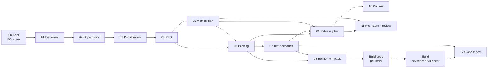

# AI Product Owner — template repo

**A reusable Claude Code workbench for Product Owners. Specialist agents draft every artefact across the product development lifecycle; you sign off each one; the tooling enforces the gates.**

This is a *template*. Clone it per project or role, swap the context files for your product and team, and run. The agents, templates, gates and traceability stay the same.

It builds on an earlier worked kit (the FlexPlan example below) and folds in artefact-discipline from CompanyName_placeholder's AI-augmented PDLC: **stable requirement IDs, BDD acceptance, and an explicit requirement → story → test traceability chain.**

*Based on work by Breitner de Souza Eremita, Product Owner, London.*

**New here?** Start with the one-page [cheatsheet](docs/cheatsheet.md). For what every agent does and when to use it, see the [agents overview](.claude/agents/AGENTS-OVERVIEW.md).

---

## The idea

AI can draft a PRD or forty stories in minutes. That's only useful if the drafts are grounded in evidence, an accountable human decides what goes forward, and there's a record of who agreed what. So: agents are a fast team of junior colleagues; the PO is the decision-maker; and nothing flows to the next stage until the PO approves — enforced by a hook and a ledger, not by trust.

## How it works



Each box is drafted by an agent and approved by the PO. A solid arrow means "can't start until the upstream box is approved". The build itself happens outside the kit, from approved build specs. One initiative = one folder under `work/<slug>/`.

### Two tracks: full and lite
Not everything needs twelve gates. Each initiative picks a track at `/new-initiative`, and the PO can switch it later with `/track`. The switch is logged.

| Track | Stages | Use it for |
|---|---|---|
| **full** | all of the above | customer-facing, regulated, A/B-tested, or needing stakeholder comms |
| **lite** | brief → PRD → backlog → test → build specs → close | small, low-risk changes, internal tools, spikes |

On lite, a skipped stage's gate passes straight through: the PRD gates on the brief. The agents are told what was skipped, and mark missing goals or baselines `[[OPEN]]` instead of inventing them.

### From backlog to builders, and back
- **`/handoff <slug> <story>`** writes a **build spec per story**: a self-contained brief that a developer or an AI coding agent (Claude Code, Copilot) can implement without opening the PRD. The requirements and acceptance criteria are copied verbatim by `pdlc.py story`, never paraphrased. The spec states what's out of scope and how to tag each test, and ends with a fixed set of **rules for AI coding agents**: don't widen scope, tag every test with its scenario ID, and stop and ask instead of guessing.
- **`/close <slug> <evidence>`** closes the loop. `pdlc.py trace --evidence` reads CI results (JUnit XML), manual test logs (CSV) or test folders, and reports each requirement as Implemented (full / partial) or with no evidence. The close agent explains every gap, flags drift from the spec, and drafts the follow-up stories.

**A typical step:** `/prd my-idea` checks the gate, hands the approved upstream docs to the `prd-writer` agent, which drafts `04-prd.md` from a template (citing sources, labelling assumptions, flagging `[[OPEN]]` decisions). An independent `artefact-critic` reviews it; `/coverage` checks every requirement is acceptance-complete. You read, give feedback (the agent revises) or `/approve` — which stamps your name and time, fingerprints the content, and logs it.

## Traceability — the chain that holds it together

Requirements get a **stable ID** in the PRD and keep it all the way down:

```
PRD requirement  UPG.010.010
      │  (story delivers it, tags its scenarios)
      ▼
Story  EU1-S3        @UPG.010.010.010
      │
      ▼
Test scenario  UPG.010.010.010
```

- IDs are never reused or renumbered once referenced. Insert with `011`–`019`.
- Every requirement carries at least one **BDD acceptance scenario**, written to a consistent rule set (explicit actor, one action per step, en-GB, no implementation detail) so it maps cleanly to automation.
- `/trace <slug>` runs a code-based check (`pdlc.py trace`): coverage per requirement, gaps, orphaned IDs, and area codes that clash with another initiative.
- **The release gate enforces it.** `/release` stays blocked while any Must requirement has no story or no test scenario.

## The agents

| Agent | Drafts / does | Command |
|---|---|---|
| `discovery-researcher` | Graded findings, JTBD, pain points from evidence | `/discover` |
| `opportunity-framer` | Problem, outcomes, sizing (low/likely/high), riskiest-assumption tests | `/frame` |
| `prioritisation-analyst` | Options, transparent RICE/WSJF, recommendation, MVP slice | `/prioritise` |
| `prd-writer` | PRD with stable-ID requirements + BDD acceptance, NFRs, risks, compliance questions | `/prd` |
| `metrics-analyst` | Metric tree, tracking plan, A/B design; later the post-launch review | `/metrics`, `/post-launch` |
| `story-writer` | Epics, INVEST stories, Gherkin AC tagged with scenario IDs, traceability | `/stories` |
| `qa-scenario-designer` | Happy/negative/edge/a11y/analytics scenarios tied to requirement IDs; AC gaps | `/test-scenarios` |
| `refinement-facilitator` | Session agenda, questions, split options; post-session changes | `/refine` |
| `release-planner` | Phased rollout, go/no-go, monitoring, rollback triggers | `/release` |
| `stakeholder-comms` | Exec update, internal notes, customer copy, support brief | `/comms` |
| `artefact-critic` | Independent rubric review of any draft | `/critique` |
| `meeting-scribe` | Decisions, actions, proposed changes from meeting notes | `/meeting` |
| **`acceptance-coverage-check`** | PRD acceptance gaps, ambiguity, malformed BDD | **`/coverage`** |
| **`traceability-report`** | Requirement → story → test coverage, gaps, orphans | **`/trace`** |
| **`three-amigos-facilitator`** | PO/Dev/QA deep-dive on one story: sharpened AC, risks | **`/three-amigos`** |
| **`glossary-sync`** | Proposes glossary additions and consistency fixes | via `/ask-agent` |
| `build-spec-writer` | Self-contained build spec per story for developers or AI coding agents | `/handoff` |
| `close-analyst` | Delivery vs PRD from test evidence; drift; follow-up stories | `/close` |

The four in **bold** are adapted from CompanyName_placeholder's PDLC agents into Claude Code format. All 18 agents are described, with when to use each, in the [agents overview](.claude/agents/AGENTS-OVERVIEW.md).

Plus `/onboard`, `/new-initiative`, `/track`, `/status`, `/next`, `/approve`, `/reopen`, `/override`, `/ask-agent`, `/setup-check`.

## How sign-off is enforced

| Layer | What it does |
|---|---|
| **Hook** (`.claude/hooks/guard.py`) | Blocks editing an approved artefact, writing `status: APPROVED`, or touching the approvals log. This covers the file tools and the shell, both Bash and PowerShell: redirects, in-place edits, moves and deletes. `scripts/test_guard.py` proves the rules hold. |
| **Permission prompt** (`.claude/settings.json`) | Approve/reopen/override go through `scripts/pdlc.py` and Claude Code asks you every time, from Bash or PowerShell. The prompt *is* the sign-off. |
| **Fingerprint** | On approval the script hashes the content; later edits show `CHANGED SINCE APPROVAL` and close downstream gates. |
| **Staleness** | If an upstream artefact is reopened and re-approved, downstream artefacts approved earlier show `STALE`. |

`context/status-legend.md` explains how the softer status words (In Review, In Refinement, …) relate to the hard ledger gate.

## The worked example

`examples/flexpay-early-upgrade/` is a complete run for a fictional handset-financing product (FlexPlan at Northwind Mobile — every name and number made up). Its filled-in context lives in `examples/flexpay-early-upgrade/context-snapshot/`, so the example stays grounded even though the live `context/` files are blank placeholders. Run `/status flexpay-early-upgrade` to see it all at once.

It runs right through to close-out:
- **`handoff/EU1-S3.md`**: a build spec for the riskiest story. Writing it surfaced a real gap: a business rule with no scenario.
- **`12-close-report.md`**: delivery checked against CI results and a manual test log. 11 of 12 Must requirements are fully implemented. The remaining gap is owned and planned, and four drift items are traced back to their source.
- Try it: `python scripts/pdlc.py trace flexpay-early-upgrade --evidence examples/flexpay-early-upgrade/inputs/ci-test-results-2026-05-01.xml examples/flexpay-early-upgrade/inputs/manual-test-log-2026-02.csv`

## Quick start

You need the Claude Code desktop app (or CLI) and Python 3.8+.

1. Clone this folder and open **this folder** as the project in Claude Code. The guard and permission rules only apply when it is the project root, not a parent folder.
2. Run `/start-here`. It checks repository state and recommends the next action.
3. Run `/setup-check`. It confirms that Python, the ledger and the sign-off guard work (Bash and PowerShell).
   Run `python scripts/validate_template.py` to check skill mirrors and the template's local structure.
4. **Make it yours:** run `/onboard`. It interviews you to fill in the product and team context, and you can paste existing material instead of typing. Filled-in examples are in the context-snapshot folder. Drop any policy docs into `context/policies/`. Until the required context is filled, every stage gate shows a warning.
5. `/new-initiative my-idea "One line about it"` and answer the brief questions.
6. Put evidence in `work/my-idea/inputs/`, `/approve` the brief, then `/discover my-idea`. From there `/next my-idea` tells you what's next.

## Using it in a new role

Swap the context files on day one — product, customers, systems, team, DoR/DoD, regulatory areas, policies. Everything else stays. Templates are plain Markdown, so output pastes into Jira, Azure DevOps, Confluence or Notion.

## Cross-agent use

The Claude skill definitions are maintained under `.claude/skills/` and mirrored under `.agents/skills/` for agents that use the `.agents` skill format.

- Read `AGENTS.md` for repository-maintaining rules.
- Read `CLAUDE.md` for Claude-specific stage routing and the approval protocol.
- Run `python scripts/validate_template.py` after adding or changing a skill.
- Keep real approval actions in the human-controlled ledger commands; a mirrored skill must not approve by itself.

GitHub Actions runs the template validator and both regression suites on pushes and pull requests.

## Limits worth knowing

- **Agents are confidently wrong sometimes.** Every artefact is reviewed, every number cites a source or says "Assumed", and the critic spot-checks. Read the drafts properly.
- **The regulatory notes are prompts for Compliance, not legal advice.** Agents never say something is compliant.
- **The guard is a safety net, not security.** It stops honest mistakes and AI shortcuts, not someone editing files by hand, and it needs Python (`/setup-check` tests it).
- **Usage limits.** A full twelve-stage run in one go will hit Pro-plan limits; run a stage or two per session.

## Repo layout

```
.claude/
  agents/        18 subagent definitions + AGENTS-OVERVIEW.md
  skills/        slash commands (stages + /onboard, /track, /handoff, /close, /trace, /coverage, …)
  hooks/         guard.py (sign-off guard)
  settings.json  permission rules and hook wiring
.agents/
  README.md      cross-agent skill mirror instructions
  skills/        mirror of the Claude skill definitions
CLAUDE.md        orchestration rules, stable-ID discipline
AGENTS.md        repository-maintenance rules for all coding agents
context/
  product-context, team, writing-style, regulatory-notes, quality-rubrics,
  glossary, status-legend
  policies/      your org's policy documents (empty by default)
templates/       one template per stage, plus handoff-spec.md (build spec per story)
scripts/
  pdlc.py        sign-off ledger: init, status, check, approve, reopen, override, track,
                 trace (+ --evidence), story (verbatim extract), context-check
  test_guard.py  proves the sign-off guard's rules (run by /setup-check)
  test_pdlc.py   regression tests for the ledger: tracks, gates, build specs, evidence
  validate_template.py  validates skill mirrors, release evidence fields and Python syntax
work/            your initiatives
examples/        the worked FlexPlan run, with its own context snapshot
docs/            cheatsheet, playbook, design notes, setup guide
CHANGELOG.md     template version history
LICENSE.md       MIT license
```

