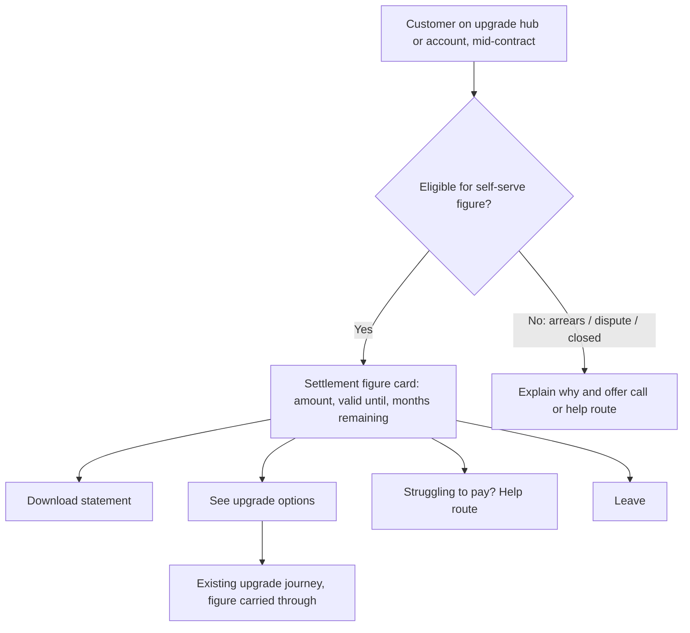

# PRD: Self-serve settlement figure (early upgrade MVP)

**Changes in this revision (after critic review and PO feedback)**
- Added `SET.030.020` and BR-05 for customers in arrears (critic: missing failure path).
- Moved the help route for customers in difficulty (`SET.030.010`) from Should to Must (PO).
- Replaced "fast" with a measurable NFR-01 (critic).
- Added the IVR option to non-goals with the Ops owner.

| | |
|---|---|
| PO | Breitner de Souza Eremita |
| Status | Approved |
| Stakeholders | Head of Digital Sales, Customer Ops lead, Credit Risk manager, Compliance partner, Finance BP, UX lead |
| Target release | A/B test live by 26 Feb 2026 |
| **Area code** | `SET` — settlement figure. Root of every stable requirement ID below. |

## 1. Problem and context
Mid-contract FlexPlan customers can't see their settlement figure without calling. 90% of mid-contract upgrade hub visitors hit a "call us" message, only 15% click it, and the mid-contract upgrade rate is 5.0% against 14.5% near the end of contract (`02-opportunity.md`). This release lets them see the figure online and carry on to upgrade.

## 2. Goals and success measures
| Goal | Metric | Baseline | Target | By when |
|---|---|---|---|---|
| More mid-contract upgrades with us | 30-day upgrade rate of mid-contract hub visitors | 5.0% | 6.5% | End of A/B test |
| Fewer settlement calls | Settlement contacts per 1,000 live agreements a month | 17.8 | 30% lower in test group | End of A/B test |
| Don't push people out | Port-out within 30 days of viewing a figure | 9% (call route) | No more than 10% | End of A/B test |

Baseline for calls: 14,200 / 800,000 x 1,000 = 17.8.

## 3. Non-goals
- Trade-in estimate next to the figure (next slice).
- Device balance in the native app (next slice).
- Rolling the balance into a new agreement (parked, see `decisions.md`).
- Paying the settlement figure online. Customers pay through the existing routes.
- IVR text-back of the figure (Customer Ops backlog, owner: Customer Ops lead).
- Any change to Credit Decisioning.

## 4. Users and scenarios
- **Upgrader:** mid-contract, sees a new phone, wants to know if upgrading now is worth it.
- **Comparer:** weighing up a competitor deal, needs the payoff figure.
- **Customer in difficulty:** lands on the page looking for ways to pay less.
- **Contact-centre agent:** gets fewer "what do I owe" calls and can see the figure the customer saw.

## 5. Scope
### In scope (MVP)
Settlement figure card on the web account and upgrade hub for mid-contract customers; downloadable settlement statement; months remaining; route into the existing upgrade journey; help route for customers in difficulty; analytics; A/B flag.
### Out of scope
See non-goals.

## 6. User journey

Alternative paths: Agreement Service unavailable (show a friendly error and the call option, never a wrong figure); figure expires while the customer is in the journey (refresh before checkout).

## 7. Functional requirements

> **Stable ID format** — carried through to stories, test scenarios, PRs and tests. Do not reuse or renumber an ID once it has been referenced downstream.
> - Requirement: `SET.<GROUP>.<ITEM>` — e.g. `SET.010.010`
> - Scenario: `SET.<GROUP>.<ITEM>.<SCN>` — e.g. `SET.010.010.010`
> - Increment by `010`; use `011`–`019` for later insertions.

### Requirements index
| ID | Requirement | Priority (MoSCoW) |
|---|---|---|
| SET.010.010 | Mid-contract customer sees a settlement figure card on the hub and in their account | Must |
| SET.010.020 | Card shows the amount, the valid-until date and months remaining | Must |
| SET.010.030 | Figure is requested in real time on load, not cached from an earlier day | Must |
| SET.010.040 | A customer with more than one agreement sees one labelled card per agreement | Must |
| SET.020.010 | Customer can download a settlement statement as a PDF | Must |
| SET.020.020 | Card links to the existing upgrade journey, which shows the same figure | Must |
| SET.020.030 | A figure that expires during the upgrade journey is refreshed before the order is placed | Must |
| SET.030.010 | Card shows a clear "Struggling to pay?" route to financial support | Must |
| SET.030.020 | Customers in arrears or dispute don't see a figure; they see a message and the support route | Must |
| SET.030.030 | If the figure can't be produced, the customer sees an explanation and the call option, never a stale or estimated figure | Must |
| SET.040.010 | Contact-centre agents can see in the CRM that a figure was viewed online, with amount and time | Should |
| SET.040.020 | All card views, downloads, link clicks and errors are tracked per the metrics plan | Must |
| SET.040.030 | The feature sits behind a flag supporting a 50/50 split by customer | Must |

### Requirement detail

#### Group 010 — Figure display

**`SET.010.010` — See the settlement figure card** · Priority: Must
A logged-in mid-contract customer sees a settlement figure card on the upgrade hub and in their web account.

- **Acceptance (BDD)**
  - **`SET.010.010.010` — Eligible customer sees the card**
    - Given the customer is logged in with one FlexPlan agreement with more than three months remaining
    - And the agreement is not in arrears or dispute
    - When the customer opens the upgrade hub
    - Then the customer sees a settlement figure card
  - **`SET.010.010.020` — Near the end of contract there is no card**
    - Given the customer has three full months or fewer remaining
    - When the customer opens the upgrade hub
    - Then the customer sees the existing end-of-contract upgrade offer and no settlement card

**Rules / notes:** BR-01 (mid-contract = more than 3 full months remaining).

**`SET.010.020` — Card content** · Priority: Must
The card shows the settlement amount, the date it is valid until, and months remaining on the agreement.

- **Acceptance (BDD)**
  - **`SET.010.020.010` — Card shows the three values**
    - Given the customer is eligible and the figure has loaded
    - When the card is displayed
    - Then the card shows the settlement amount and the valid-until date and the months remaining

**Rules / notes:** Wording needs Compliance sign-off.

**`SET.010.030` — Real-time figure** · Priority: Must
The figure is requested from the Agreement Service when the card loads, not cached from an earlier day.

- **Acceptance (BDD)**
  - **`SET.010.030.010` — Figure requested on load**
    - Given the customer opens a page with the settlement card
    - When the card loads
    - Then the figure is requested from the Agreement Service at that time
  - **`SET.010.030.020` — Same figure on a repeat view the same day**
    - Given the customer viewed a figure earlier today
    - When the customer returns to the card later the same day
    - Then the customer sees the same amount and valid-until date

**Rules / notes:** BR-03 (one figure per agreement per day).

**`SET.010.040` — One card per agreement** · Priority: Must
A customer with more than one agreement sees one card per agreement, each labelled with the device.

- **Acceptance (BDD)**
  - **`SET.010.040.010` — Two eligible agreements**
    - Given the customer has two eligible agreements
    - When the customer opens the upgrade hub
    - Then the customer sees two cards each labelled with the device name
  - **`SET.010.040.020` — One eligible and one in arrears**
    - Given the customer has one eligible agreement and one agreement in arrears
    - When the customer opens the upgrade hub
    - Then the customer sees the figure for the eligible agreement and the arrears message for the other

**Rules / notes:** BR-04.

#### Group 020 — Statement and onward journey

**`SET.020.010` — Download a statement** · Priority: Must
The customer can download a settlement statement as a PDF.

- **Acceptance (BDD)**
  - **`SET.020.010.010` — Download the statement**
    - Given the customer can see the settlement figure
    - When the customer selects download statement
    - Then a PDF is produced showing the amount and the validity date and the agreement number and the device
  - **`SET.020.010.020` — Statement is accessible**
    - Given the customer uses a screen reader
    - When the customer opens the downloaded statement
    - Then the headings and amount and dates are read in a logical order

**Rules / notes:** Content per Compliance. NFR-02.

**`SET.020.020` — Into the upgrade journey** · Priority: Must
The card links to the existing upgrade journey, which shows the same figure.

- **Acceptance (BDD)**
  - **`SET.020.020.010` — Figure matches at the order summary**
    - Given the customer saw a figure on the card
    - When the customer continues to the order summary on the same day
    - Then the order summary shows the same amount to settle the current agreement
  - **`SET.020.020.020` — Journey cannot get a figure**
    - Given the Agreement Service is unavailable
    - When the order summary loads
    - Then the customer cannot place the order and is shown how to call

**`SET.020.030` — Refresh an expired figure** · Priority: Must
If the figure expires during the upgrade journey, it is refreshed before the order is placed.

- **Acceptance (BDD)**
  - **`SET.020.030.010` — Figure expires mid-journey**
    - Given the figure expires while the customer is in the upgrade journey
    - When the order summary loads
    - Then a new figure is fetched and shown
    - And the customer sees a message that the amount has been updated

#### Group 030 — Eligibility and support

**`SET.030.010` — Help route** · Priority: Must
The card shows a clear "Struggling to pay?" route to the financial support page and phone line.

- **Acceptance (BDD)**
  - **`SET.030.010.010` — Help route visible**
    - Given the customer can see the settlement card or an ineligible message
    - When the customer looks below the figure
    - Then the customer sees a struggling to pay route to financial support
  - **`SET.030.010.020` — Help route does not depend on the figure loading**
    - Given the Agreement Service is unavailable
    - When the card shows an error
    - Then the struggling to pay route is still shown

**Rules / notes:** Consumer Duty.

**`SET.030.020` — No figure when ineligible** · Priority: Must
Customers in arrears or with a disputed agreement don't see a figure; they see a message and the support route.

- **Acceptance (BDD)**
  - **`SET.030.020.010` — Agreement in arrears**
    - Given the agreement is in arrears
    - When the customer opens the upgrade hub
    - Then the customer sees no figure and a message offering a call and the financial support link
  - **`SET.030.020.020` — Agreement in dispute**
    - Given the agreement is flagged as in dispute
    - When the customer opens the upgrade hub
    - Then the customer sees no figure and a message to contact the team handling the case

**Rules / notes:** BR-05.

**`SET.030.030` — Never show a wrong figure** · Priority: Must
If the figure can't be produced, the customer sees an explanation and the call option, never a stale or estimated figure.

- **Acceptance (BDD)**
  - **`SET.030.030.010` — Service unavailable**
    - Given the Agreement Service does not respond within the time limit
    - When the card loads
    - Then the customer sees an explanation and the phone number
    - And no amount is shown
  - **`SET.030.030.020` — Malformed amount**
    - Given the Agreement Service returns a missing or malformed amount
    - When the card loads
    - Then the response is treated as an error and no amount is shown

#### Group 040 — Operations, analytics and rollout

**`SET.040.010` — Agents can see the figure viewed** · Priority: Should
Contact-centre agents can see in the CRM that a figure was viewed online, with the amount and time.

- **Acceptance (BDD)**
  - **`SET.040.010.010` — Figure view recorded in the CRM**
    - Given the customer viewed a figure online
    - When an agent opens the customer's CRM record
    - Then the contact history shows the amount and the valid-until date and the time it was viewed

**`SET.040.020` — Analytics** · Priority: Must
All card views, downloads, link clicks and errors are tracked per the metrics plan.

- **Acceptance (BDD)**
  - **`SET.040.020.010` — Events fire once and carry no financial data**
    - Given the customer is in the treatment arm
    - When the customer views a figure and downloads a statement and clicks see upgrade options
    - Then each event fires once
    - And no event contains a monetary amount

**Rules / notes:** NFR-04.

**`SET.040.030` — A/B flag** · Priority: Must
The feature sits behind a flag that supports a 50/50 split by customer.

- **Acceptance (BDD)**
  - **`SET.040.030.010` — Stable assignment**
    - Given a customer is assigned to the treatment arm
    - When the customer returns on another device
    - Then the customer is still in the treatment arm
  - **`SET.040.030.020` — Assignment export**
    - Given the test is running
    - When the daily export runs
    - Then the warehouse holds the customer identifier and arm and assignment date for every enrolled customer

## 8. Business rules
| ID | Rule |
|---|---|
| BR-01 | Mid-contract means more than 3 full months remaining on the device agreement |
| BR-02 | Validity period of the figure is set by Compliance [[Compliance to confirm the period]] |
| BR-03 | One figure per agreement per day is generated; repeat views that day show the same figure |
| BR-04 | Customers with more than one agreement see one card per agreement |
| BR-05 | No figure is shown if the agreement is in arrears, in dispute, or flagged for financial support |

## 9. Non-functional requirements
| ID | Requirement |
|---|---|
| NFR-01 | Card shows a figure or an error within 3 seconds for 95% of loads |
| NFR-02 | Accessible to WCAG 2.2 AA, including the PDF statement |
| NFR-03 | Every figure generated is logged with agreement ID, amount, validity date and channel, kept for the agreement's retention period |
| NFR-04 | No settlement figure appears in analytics payloads or URLs (personal financial data) |
| NFR-05 | Works on mobile viewports first; about 70% of traffic is mobile |

## 10. Data and integrations
- **Agreement Service:** settlement amount, validity date, months remaining, arrears / dispute status.
- **Document generation:** settlement statement PDF.
- **CRM:** record that a figure was viewed (`SET.040.010`).
- **Product analytics:** events from the metrics plan.
- **Feature flag service:** split by customer ID.

## 11. Regulatory and compliance considerations
Questions for the Compliance partner (not conclusions):
1. What must the card and statement show, and does the statement satisfy a request for a settlement statement?
2. What validity period should we use (BR-02)?
3. Is the "Struggling to pay?" route enough for consumer support, and what should it say?
4. How do we evidence consumer understanding (usability test results, comprehension questions)?
5. Do we need to tell customers anything about credit checks if they then go into the upgrade journey?

## 12. Content and comms needs
Card copy, statement template, error and ineligible messages, help route copy, support FAQs. All credit-related wording to Compliance.

## 13. Dependencies
| Dependency | Owner | Needed by |
|---|---|---|
| Agreement Service real-time figure endpoint | Backend lead | Sprint 2 |
| Compliance wording and validity period | Compliance partner | Sprint 2 |
| Financial support page and phone line details | Customer Ops lead | Sprint 3 |
| Finance confirmation of upgrade value | Finance BP | Before release plan |

## 14. Risks and mitigations
| Risk | Likelihood | Impact | Mitigation | Owner |
|---|---|---|---|---|
| Figure shown is wrong | Low | High | Real-time call, no estimation, reconciliation check in test | Backend lead |
| More customers pay off and leave | Medium | Medium | A/B with port-out guardrail and stop rule | PO |
| Agreement Service can't meet NFR-01 | Medium | Medium | Spike in sprint 1; fallback message | Backend lead |
| Compliance wording late | Medium | High | Share draft copy in sprint 1 | PO |
| Vulnerable customers pushed to upgrade | Low | High | SET.030.010, SET.030.020, BR-05; Ops review of help route | PO, Customer Ops lead |

## 15. Release approach
Feature flag, internal staff first, then 50/50 A/B for mid-contract customers for at least four weeks. Detail in the release plan.

## 16. Open questions
| # | Question | Who can answer | Needed by |
|---|---|---|---|
| 1 | Validity period (BR-02) | Compliance partner | Sprint 2 |
| 2 | Upgrade value per customer for the business case | Finance BP | Release plan |
| 3 | Does the upgrade journey already handle a figure passed in, or is that new work? | Frontend lead | Refinement |

## Assumptions the agent made
- 800,000 live agreements from `context/product-context.md` for the contact rate baseline.

---

## Appendix: BDD acceptance writing rules
Apply these to every Given/When/Then scenario in this PRD and downstream.

**Style**
- Use explicit actor phrasing in every step: `Given the customer ...`, `When the customer ...`.
- One primary action per `When` step. One observable outcome per `Then`/`And`.
- Keep implementation detail out of step text — no API endpoints, CSS/HTML, framework names, or technical identifiers.
- Use en-GB spelling. Avoid contractions.

**Structure**
- One scenario tests one behaviour. Prefer several focused scenarios over one compound scenario.
- `Given` describes a state or precondition, not a sequence of actions.
- Use parameterised placeholders where values vary rather than hardcoding strings.

**So that automation maps cleanly**
- Write each step so it maps to one action (Given/When) or one check (Then) in downstream test automation.
- Use a consistent verb vocabulary across all scenarios.
